<!--
  SABER://DIGITAL-WORLD — GitHub profile README
  All visuals live in ./assets (SVG + one PNG) and are referenced with relative paths.
  Regenerate them with: python scripts/build_portrait.py && python scripts/build_assets.py
  assets/diagnostics.svg is refreshed daily by .github/workflows/diagnostics.yml
-->

<div align="center">
  
</div>

<div align="center">
  
</div>

<p align="center">
  <a href="https://www.linkedin.com/in/saber-barhoumi-b709b9208/"><b>LinkedIn</b></a> &nbsp;·&nbsp;
  <a href="https://x.com/SaberSa04452697"><b>X</b></a> &nbsp;·&nbsp;
  <a href="https://www.facebook.com/saber.barhoumi.792/"><b>Facebook</b></a> &nbsp;·&nbsp;
  <a href="https://github.com/saber-barhoumi?tab=repositories"><b>All repositories</b></a>
</p>

<p align="center">
  <b>Full-Stack Developer</b> building <a href="https://github.com/saber-barhoumi/Xpark-gmao"><b>XPARK GMAO</b></a>,
  a microservices platform for fleet, mission and maintenance management — my final-year graduation project —
  and exploring applied AI/ML with <a href="https://github.com/saber-barhoumi/CryptoVisionAI"><b>CryptoVisionAI</b></a>.
</p>



```text
   _____ ___    ____  __________
  / ___//   |  / __ )/ ____/ __ \
  \__ \/ /| | / __  / __/ / /_/ /
 ___/ / ___ |/ /_/ / /___/ _, _/
/____/_/  |_/_____/_____/_/ |_|
```

```text
$ cat about-me.txt
name        : Saber Barhoumi
handle      : @saber-barhoumi
role        : Full-Stack Developer
building    : XPARK GMAO — fleet, mission & maintenance platform (graduation project)
exploring   : microservices · AI/ML (CNNs, RAG agents) · cloud & DevOps (in training)
experience  : internship at Smart Tunisian Technopark (S2T)
```



```text
$ ./tech-stack.sh --verified
frontend  : React · TypeScript · Next.js · Angular · Vite · Expo/React Native · Leaflet · Sass
backend   : .NET 8 (ASP.NET Core) · Spring Boot · Express · FastAPI · Symfony · Prisma
data/msg  : PostgreSQL · MongoDB · RabbitMQ · Qdrant · EF Core · SignalR
ai/ml     : Python · TensorFlow · PyTorch · scikit-learn · XGBoost · OpenCV · pandas · Ollama · RAG
devops    : Docker · Docker Compose · Nginx
learning  : Kubernetes · Jenkins · Keycloak · Kafka · AWS
tools     : Git · GitHub · Swagger/OpenAPI · Power BI · Miro
```





**[`Xpark-gmao`](https://github.com/saber-barhoumi/Xpark-gmao)** is a transport-operations platform that joins fleet management, missions with live GPS tracking, maintenance (GMAO) and invoicing in one containerised system. What the repository contains:

- **Backend — 8 ASP.NET Core 8 microservices** (IAM, Fleet, Mission, Maintenance, Finance, Alerts, Chat, PredictionPanne). Each follows Clean Architecture (`API → Application → Domain ← Infrastructure`) with EF Core on PostgreSQL, JWT authentication, MFA, RabbitMQ messaging through MassTransit, and SignalR for real-time chat. Behind an Nginx gateway.
- **Client portal — Next.js 14**: live tracking map, finances, documents, analytics, support, transport-request booking and an embedded AI assistant.
- **Back-office — React + Vite + TypeScript**: admin console using TanStack Query, React Router, Leaflet maps and a SignalR client.
- **Driver app — Expo / React Native**: drivers see their missions and the phone sends background GPS pings to `Mission.API`, so customers watch the truck move on the portal map.
- **AI services (Python / FastAPI)**:
  - *Price predictor* — XGBoost-based trip-cost prediction API.
  - *Fleet optimizer* — assignment engine combining a greedy start, a genetic algorithm and local search under hard constraints.
  - *IBOA* — consumes RabbitMQ events, scores them 1–100, de-duplicates and formats alerts for delivery.
  - *Ayshaa* — an agent that routes between an LLM, a hybrid RAG pipeline (Qdrant dense search + BM25, multilingual embeddings) and live API tools; answers in French, English and Tunisian Arabic; optional local LLM through Ollama.
- **Predictive maintenance**: a rule-based engine behind an `IPredictionEngine` interface — the designed integration point for a future ML model.
- **Infrastructure**: Dockerfiles for each service and a `docker-compose.yml` defining 20 services, with health checks. Documentation spans ~100 Markdown files.

**Explore the code:**
[Clean Architecture overview](https://github.com/saber-barhoumi/Xpark-gmao/blob/main/microservices/CLEAN-ARCHITECTURE.md) ·
[Predictive maintenance design](https://github.com/saber-barhoumi/Xpark-gmao/blob/main/microservices/PredictionPanne/ARCHITECTURE.md) ·
[Client portal docs](https://github.com/saber-barhoumi/Xpark-gmao/blob/main/docs/portail-client/README.md) ·
[Ayshaa agent](https://github.com/saber-barhoumi/Xpark-gmao/blob/main/AyshaaRAG/README.md) ·
[Fleet optimizer](https://github.com/saber-barhoumi/Xpark-gmao/blob/main/OptimisateurFlotteIA/README.md) ·
[Driver app](https://github.com/saber-barhoumi/Xpark-gmao/blob/main/xpark-driver/README.md) ·
[docker-compose.yml](https://github.com/saber-barhoumi/Xpark-gmao/blob/main/docker-compose.yml)




**[`CryptoVisionAI`](https://github.com/saber-barhoumi/CryptoVisionAI)** explores whether a convolutional network can classify short-term crypto price direction from candlestick chart *images*. The repository implements:

- a **data pipeline** that turns Binance 1-minute OHLCV data into 224×224 candlestick images from 30-candle windows, labelled by the 5-bar forward return with a ±0.15 % threshold (USDT and BTC pairs, 70/15/15 split);
- **two model families** — a custom 4-block CNN and a ResNet50 transfer-learning option — written in both **TensorFlow** and **PyTorch**.

> **Status, stated plainly:** this is a research implementation. Trained weights, accuracy figures and backtests are **not** published in the repository, so I make no performance claims here.

**Explore the code:**
[README](https://github.com/saber-barhoumi/CryptoVisionAI/blob/main/README.md) ·
[`data_preparation/`](https://github.com/saber-barhoumi/CryptoVisionAI/tree/main/data_preparation) ·
[`models/`](https://github.com/saber-barhoumi/CryptoVisionAI/tree/main/models)



```text
$ tree ./projects -L 1
projects/
├── Xpark-gmao/                  ★ flagship  · .NET 8 microservices · React · Next.js · Expo · Python AI
├── CryptoVisionAI/              ★ featured  · CNN on candlestick charts · TensorFlow + PyTorch
├── EdukaApp-Springboot-Angular-Micro-services/   · Spring Boot · Angular · microservices
├── SynergyPark-MERN-Stack/      · MongoDB · Express · React · Node.js
├── AfriLink-nextjs-prisma/      · Next.js · Prisma · PostgreSQL
├── SpeedyGo-SpringBoot-Angular/ · Spring Boot · Angular
├── Skier_Spring_Boot/           · Spring Boot
├── Salle_De_Sport_Symfony/      · Symfony
├── fifa-2022-powerbi-analytics/ · Power BI
└── …more on GitHub
```

[EdukaApp](https://github.com/saber-barhoumi/EdukaApp-Springboot-Angular-Micro-services) ·
[SynergyPark](https://github.com/saber-barhoumi/SynergyPark-MERN-Stack) ·
[AfriLink](https://github.com/saber-barhoumi/AfriLink-nextjs-prisma) ·
[SpeedyGo](https://github.com/saber-barhoumi/SpeedyGo-SpringBoot-Angular) ·
[Skier](https://github.com/saber-barhoumi/Skier_Spring_Boot) ·
[Salle de Sport](https://github.com/saber-barhoumi/Salle_De_Sport_Symfony) ·
[FIFA 2022 Power BI](https://github.com/saber-barhoumi/fifa-2022-powerbi-analytics)



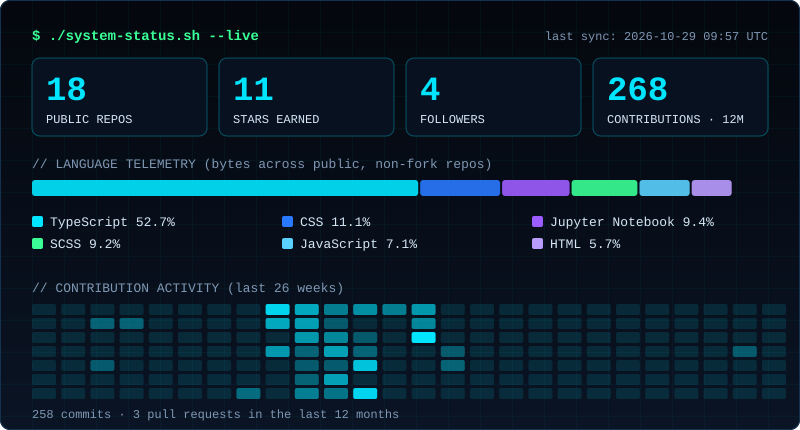

<sub>Telemetry is generated from the GitHub API by a scheduled workflow — no hardcoded numbers. Live totals are always on [my profile](https://github.com/saber-barhoumi).</sub>



<p align="center">
  <a href="https://www.linkedin.com/in/saber-barhoumi-b709b9208/"><b>LinkedIn</b></a> &nbsp;·&nbsp;
  <a href="https://x.com/SaberSa04452697"><b>X</b></a> &nbsp;·&nbsp;
  <a href="https://www.facebook.com/saber.barhoumi.792/"><b>Facebook</b></a>
</p>

